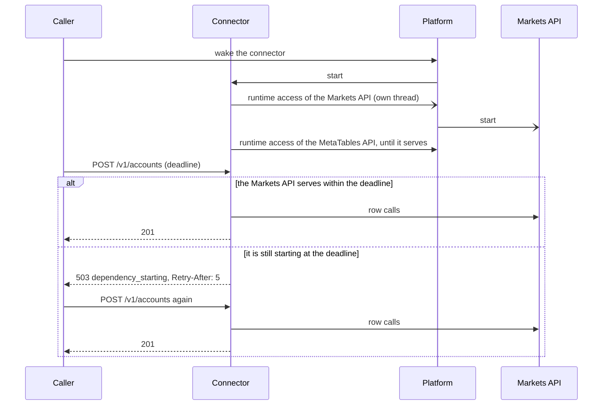

# ADR 0020: Dependencies That Are Starting

## Status

Proposed on 2026-11-12 for
[issue #18](https://github.com/mainsequence-projects/alpaca-connectors/issues/18), and implemented
by the same change. Decision 2 bounds a wait by the caller's deadline only with mainsequence
9.0.39 or later, whose request identity reads that deadline (SDK ADR 0041); this repository locks
9.0.38, so until the SDK is raised a row call waits for ms-markets' own limit.

## Context

The connector scales to zero, and so do the two Main Sequence releases it works through:

- the **Markets API**, which ms-markets finds in the caller's Environment on the first Markets row
  call ([ADR 0018](0018_markets_api_boundary.md); `msm.client.discovery`);
- the **MetaTables API**, which `metatables.endpoint` finds when the runtime attaches this
  project's tables at startup, and asks again when its release token is refreshed.

Each library asks the platform for the release's runtime access, which also starts a release that
is asleep, then asks again every few seconds until the release serves or 30 s pass. An application
that wakes the connector before its work still met an asleep Markets API: the
connector found it only on the first row call of `POST /v1/accounts`, waited 30 s for it, and
answered the generic `503 dependency_unavailable`, which a caller cannot tell from a broken
connector. The Markets API served 5 s later.

Separately, `api_http_error` answered every `ValueError` as `409 action_conflict` with the
exception's text. A pydantic `ValidationError` is a `ValueError`, so a provider payload that its
model refused (an Alpaca asset on an exchange the model does not list) reached the caller as a
conflict carrying the validation dump.

## Decision

1. **Start the Markets API with the connector.** The API's startup starts finding the Markets API
   on its own thread before it attaches the runtime (`alpaca_connectors.dependencies`,
   `prewarm_dependencies`). Asking the platform for the release's runtime access starts it, so the
   Markets API wakes while the connector does. Startup never waits for it and never fails because
   of it: a failure is logged, and the first row call asks again. Only a hosted release does this
   (the SDK's deployment markers); locally and in tests nothing is asked. The MetaTables API needs
   no separate start: the runtime attachment that follows starts it and waits for it, as before.
2. **Wait only as long as the caller.** Markets row calls go through `MarketsApiBackend`, the
   ms-markets lazy backend whose discovery runs on its own thread, one at a time, outside any
   request. A row call waits for it at most as long as the request's caller will still wait
   (`Mainsequence-Request-Timeout-Ms`, less 1 s for the answer), then gives up; the discovery goes
   on, so the caller's retry finds the Markets API. A call whose caller set no deadline (a Job,
   the CLI, a caller that sends none) waits for ms-markets' own limit, as before.
3. **Answer a start as a start.** A request that meets a release still starting answers
   `503` with `{"code": "dependency_starting", "retryable": true}`, a fixed message that names no
   service, and `Retry-After: 5`. A start is: a row call that gave up at its caller's deadline; an
   ms-markets or MetaTables discovery that gave up while the platform still reported the release
   waking (also when it was raised from another error, as a MetaTables token refresh raises it); and
   the SDK's own `ReleaseReadinessTimeoutError`, `ReleaseDeadlineTooShortError` and
   `ReleaseColdStartTimeoutError`. A release the platform reports unavailable, or one that cannot
   be found, stays the generic `503 dependency_unavailable`. Errors no route maps get the same
   answer.
4. **A provider payload the connector cannot read is a provider failure.** A pydantic
   `ValidationError` answers `502 provider_failure` with a fixed message; the log records the model
   and where and why each field failed, never the values. `409 action_conflict` stays for the
   conflicts the connector raises itself, in its own words.

## Consequences

- A caller can retry a `dependency_starting` answer by itself. An account registration is written
  by upsert on the Alpaca account's identity, so it can be sent again; a repeat that completes
  publishes one more holdings snapshot.
- An account sync that meets a start records its operation as failed with `dependency_starting`
  and `retryable: true`, and still answers `200`, as for every capture failure.
- Telling a waking discovery from a failed one reads the state that ms-markets and MetaTables put
  in their message (`last state: waking`); the tests drive both libraries' own discovery code with
  fake platform answers, so a change of either message fails them. If either library adopts the
  SDK's release calls, their errors are recognised already.
- A row call whose caller set a deadline may give up while the Markets API discovery is still
  asking the platform rather than waiting for a start; the answer is the same and so is the retry.
- A MetaTables token refresh and a Markets token refresh still wait for their library's own limit;
  only the first Markets discovery of a process is bounded by the caller's deadline.
