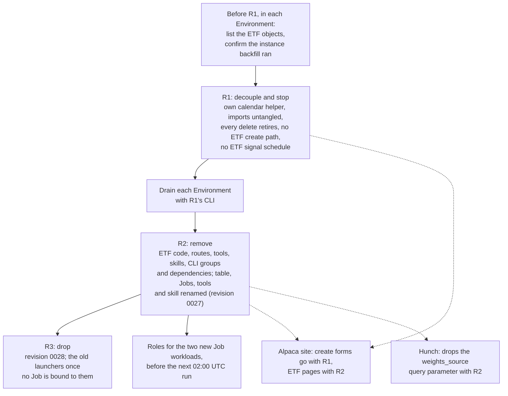
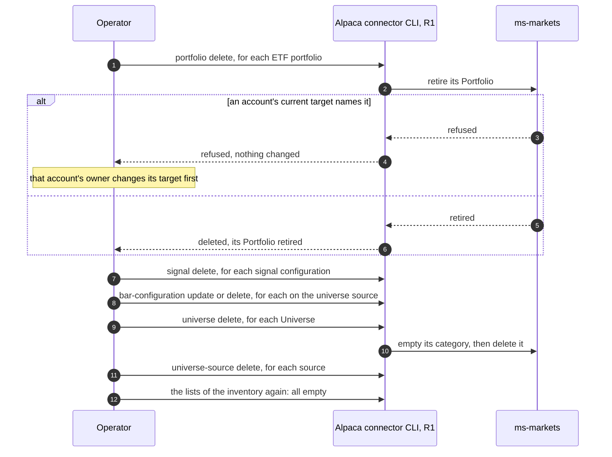
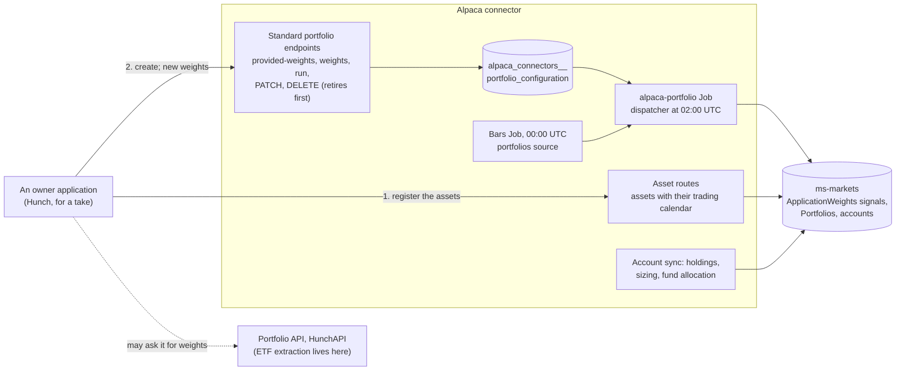

# ADR 0027: One Portfolio Path

## Status

Decided by the owner on 2026-11-17. Not implemented yet: three releases carry it out, with a drain
of each Environment between the first two ([Rollout](#rollout)).

It supersedes:

- [ADR 0001](0001_etf_holdings_asset_category_ownership.md) and
  [ADR 0005](0005_asset_universe_run_owns_constituent_registration.md): Universe Sources, Asset
  Universes and their holdings categories;
- [ADR 0006](0006_universe_backed_alpaca_etf_signal.md) and
  [ADR 0007](0007_one_signal_configuration_per_job.md): the ETF signal, its configurations and
  its Job;
- [ADR 0002](0002_etf_holdings_alpaca_portfolio_construction.md): portfolios that track an ETF.
  The valuation it introduced, on interpolated Alpaca bars, stays as ADRs 0008, 0009 and 0024
  state it.

It amends:

- [ADR 0003](0003_stored_alpaca_bars_configurations_and_asset_sources.md): the `universe` asset
  source goes; `assets`, `account_holdings` and `portfolios` remain;
- [ADR 0008](0008_portfolio_configuration_and_job_ownership.md): a portfolio configuration names
  provided weights only, and its table and Jobs lose the ETF in their names;
- [ADR 0013](0013_workflow_declared_configuration_jobs.md): one kind of configuration Job remains,
  the portfolio Job, with its dispatcher;
- [ADR 0024](0024_portfolios_from_provided_weights.md): one weights source, and every delete
  retires the `Portfolio` (its open question 5);
- [ADR 0026](0026_assets_are_registered_with_their_trading_calendar.md): the calendar helper is
  the connector's own.

## Context

### Two products in one connector

Since ADR 0024 a portfolio configuration has one of two weights sources:

- **`provided`.** An application gives the weights through the standard endpoints and owns the
  portfolio; its signal is ms-markets' `ApplicationWeights`. Hunch builds every take this way
  (Hunch ADR 0030, decision 7).
- **`etf_signal`.** The connector's own ETF product. A Universe Source names an issuer's holdings
  page. An Asset Universe extracts the ETF's holdings with `etfhextractor`, registers the
  constituents, keeps them as an ms-markets `AssetCategory` and publishes their weights as the
  ETF signal. A signal configuration runs that every day at 00:30 UTC, and an ETF portfolio
  follows the signal. These portfolios have no owner.

The ETF product sits beside the venue work as a second product, and parts of the first carry its
name:

| Kind | ETF only | Shared, under an ETF name or with an ETF branch |
| --- | --- | --- |
| Routes | `/v1/universe-sources` (7), `/v1/universes` (15), `/v1/signal-jobs` (12), and `POST /v1/portfolio-configurations`, which creates only ETF portfolios | the portfolio list and detail (`weights_source`, `signal_configuration_uid`, `linked_signal`); the bars `universe` source; `supported_component_providers` and `universe_source_count` in `GET /v1/project-state/configuration`; the capability catalog |
| Agent tools (of 17) | `alpaca_query_universes`, `alpaca_manage_universe`, `alpaca_query_etf_signals`, `alpaca_manage_etf_signal` | `alpaca_query_etf_portfolios`, `alpaca_manage_etf_portfolio` |
| Agent skills (of 6) | `alpaca-holdings-category`, `alpaca-etf-weight-signals` | `alpaca-etf-portfolios`, `alpaca-stock-bars` |
| CLI | `universe-source`, `universe`, `signal` | `portfolio create`; `--asset-source universe` on bar configurations |
| Jobs | `alpaca-etf-signal` and its dispatcher, 00:30 UTC | `alpaca-etf-portfolio` and its dispatcher, 02:00 UTC, which run both kinds |
| Tables | `alpaca_connectors__universe_source`, `__asset_universe`, `__etf_signal_job_configuration` | `alpaca_connectors__etf_portfolio_configuration` (`AlpacaETFPortfolioConfigurationTable`), which holds both kinds; `universe_uid` on bar configurations |
| Code | the `universes` package, `portfolios/alpaca_etf_signal.py`, the signal operations | `weights_source` branches in the portfolio identifier, the configuration resolution, the portfolio graph and the bars scope |

### The extraction library

`etfhextractor` reads holdings from the issuers' pages (iShares, Invesco, State Street, Vanguard),
and also carries a category plan, an ETF signal and a portfolio assembly. Installing it installs
ms-markets, MetaTables and the Main Sequence SDK, and its releases follow ms-markets: the connector
moved it four times in six days (0.5.3 to 0.6.0). It is released only as Git tags.

Since ADR 0026 the venue work needs it too. Its `ensure_trading_calendar`, 20 lines over
ms-markets' `Calendar`, stores the calendar for every asset write, every holdings capture, every
portfolio run and every provided-weights create. Package imports load it in the bars, portfolio,
operations and migration packages even where nothing calls it. `playwright`, a direct dependency
for its browser fallback, is imported by no code of the connector.

### Deleting a portfolio

`DELETE` on a provided-weights portfolio retires its `Portfolio` before deleting the
configuration (ADR 0024). An ETF portfolio's `DELETE`, and the CLI's `portfolio delete` for either
kind, delete the configuration row alone and leave a live `Portfolio` that nothing configures
(ADR 0024, open question 5).

## Decision

### 1. One path

The connector keeps one kind of signal and one kind of portfolio: a portfolio built from weights
an application provides ([ADR 0024](0024_portfolios_from_provided_weights.md)), whose signal is
ms-markets' `ApplicationWeights`. An application creates it over HTTP and owns it. No Agent tool or
CLI command creates one or gives it weights (ADR 0024, decision 7).

### 2. The ETF product and its dependency go

Nothing about ETFs stays in the connector: no `etfhextractor`, no Universe Sources, no Asset
Universes, no holdings categories, no ETF signals, no ETF portfolios, and no ETF in any name.

- **Routes.** `/v1/universe-sources`, `/v1/universes`, `/v1/signal-jobs` and
  `POST /v1/portfolio-configurations` go. Portfolio configurations keep the list, the detail,
  `PATCH`, `DELETE`, `actions/run`, `runs`, `POST .../provided-weights` and
  `POST|GET .../{uid}/weights`. Their responses lose `weights_source`, `signal_configuration_uid`
  and `linked_signal`, and the list its `signal_configuration_uid` and `weights_source` filters.
- **Bars.** The `universe` asset source goes. `assets`, `account_holdings` and `portfolios`
  remain.
- **The rest of the API.** `GET /v1/project-state/configuration` loses
  `supported_component_providers` and `universe_source_count`, and the capability catalog its
  Universes capability. The mapping of extraction errors to `502 provider_failure` goes.
  Removing an account no longer disables signal configurations, and the instance backfill no
  longer moves ETF signals.
- **CLI.** The `universe-source`, `universe` and `signal` groups go, and so does
  `portfolio create`. `portfolio` keeps `list`, `get`, `update`, `delete`, `run`, `runs`, the
  `rebalance` subcommands and `prepare-interpolated-prices`, without `--signal-configuration-uid`.
  Bar configurations lose `--asset-source universe` and `--universe-uid`.
- **Agent.** The four Universe and signal tools go, so 17 tools become 13, and two skills go, so
  6 become 4 (decision 5).
- **Dependencies.** `etfhextractor` with its `[tool.uv.sources]` entry, `playwright` and
  `scripts/install_browser_runtime.sh` go; `uv.lock` and `requirements.txt` are regenerated.
- **Where the extraction goes.** The ETF extraction logic moves to the portfolio API, in the
  HunchAPI repository. A portfolio that tracks an ETF may come later from the portfolio API. It
  would reach this connector as provided weights, through the same endpoints, and needs nothing
  here.

### 3. The calendar helper is the connector's own

`alpaca_connectors.assets.calendars.ensure_trading_calendar` replaces `etfhextractor.calendars`
with the same rule: one `Calendar.filter` for the calendar, and when it is missing, one
`Calendar.create_from_pandas_calendar`, from pandas-market-calendars' `24/7` calendar for the
always-open identifiers (`24/7`, `CRYPTO_24_7`). It serves the four callers of ADR 0026:

- the asset registration, which the asset routes, the account registration, every holdings
  capture, the account sync and the order execution reach;
- the portfolio graph;
- the provided-weights create;
- the `asset link-calendars` command.

ms-markets already requires `pandas-market-calendars`, so nothing new is installed. ADR 0026's
decisions are otherwise unchanged.

### 4. Every delete retires

Every path that deletes a portfolio configuration ends the portfolio as ADR 0024 does
([Ending a portfolio](0024_portfolios_from_provided_weights.md#ending-a-portfolio)): it retires the
`Portfolio` first, through `MarketsClient.retire_portfolio`, then deletes the row. That is
`DELETE /v1/portfolio-configurations/{uid}`, the Agent's delete and
`alpaca-connectors portfolio delete --execute`, for every portfolio.

- **Refused while a target names it.** Markets refuses while an account's current target names
  the portfolio. The API answers `409 portfolio_in_account_target`, names no account, and changes
  nothing.
- **ADR 0024's open question 5.** This is its answer. From R1 it covers the ETF portfolios too,
  which is how the drain retires them.

### 5. Names without ETF

| Before | After |
| --- | --- |
| table `alpaca_connectors__etf_portfolio_configuration`, class `AlpacaETFPortfolioConfigurationTable` | `alpaca_connectors__portfolio_configuration`, `PortfolioConfigurationTable`, created by revision `0027` with every row copied under its own uid (Hunch keeps them as `Take.portfolio_configuration_uid`); no `weights_source`, no `signal_configuration_uid`, and the owner pair is required |
| Jobs `alpaca-etf-portfolio` and `alpaca-etf-portfolio-dispatcher` (02:00 UTC) | `alpaca-portfolio` ("Alpaca Portfolio", `src/jobs/run_alpaca_portfolio.py`) and `alpaca-portfolio-dispatcher` ("Alpaca Portfolio Dispatcher", `src/jobs/dispatch_alpaca_portfolio.py`, 02:00 UTC) |
| Jobs `alpaca-etf-signal` and `alpaca-etf-signal-dispatcher` (00:30 UTC) | none |
| tools `alpaca_query_etf_portfolios`, `alpaca_manage_etf_portfolio` | `alpaca_query_portfolios`, and `alpaca_manage_portfolio`: run, and pause, resume or delete for the portfolio's owner, with no create |
| tools `alpaca_query_universes`, `alpaca_manage_universe`, `alpaca_query_etf_signals`, `alpaca_manage_etf_signal` | none |
| skills `alpaca-holdings-category`, `alpaca-etf-weight-signals`, `alpaca-etf-portfolios` | `alpaca-portfolios` only; `alpaca-stock-bars` names the `portfolios` source |
| `SIGNAL_IDENTITY_CLASS_IMPORT_PATH` and the identifier prefix `ALPACA_ETF_PORTFOLIO__`, frozen identities in `AGENTS.md` | no code computes them; the signal UIDs and portfolio identifiers already stored stay as data |

A provided-weights portfolio keeps its identity. Its configuration uid is copied, so its
`ALPACA_PORTFOLIO__<uid hex>` identifier and its `ApplicationWeights` signal UID, which depends on
the connector's namespace and that uid only (ADR 0024, decision 2), do not change.

### 6. Stored history stays

- **Signal observations.** ETF signal observations stay in the signal weights instance
  (`alpaca_connectors__signalweightsts__main`) under their signal UIDs.
- **Retired portfolios.** A retired portfolio keeps its `Portfolio` row, its series in this
  connector's instances and its catalog registration (ADR 0024).
- **History an account referenced.** Nothing deletes it. A portfolio that an account's current
  target names cannot be retired until that account's owner changes the target, and the connector
  never changes a target.
- **What goes.** Configurations: the Universe Sources, the Universes with their ms-markets
  categories and memberships, the signal configurations and the ETF portfolio configurations.
  Their tables go in R3.

## Rollout



Every release passes the repository's validation and Hunch's integration tests against an
Environment that is not Production: the provided-weights path becomes the only one, and it has
not run end to end against a hosted Markets API (ADR 0024).

### Before R1: what each Environment holds

From a checkout of the branch that deploys to the Environment (`main` for Production), with the
session of a person who holds `data_writer` on `alpaca-connectors`:

```bash
alpaca-connectors portfolio list --limit 100            # ETF portfolios: "weights_source": "etf_signal"
alpaca-connectors signal list --limit 100
alpaca-connectors universe list --limit 100
alpaca-connectors universe-source list --limit 100
alpaca-connectors market-data bar-configuration list --asset-source universe --limit 100
```

The API lists the same objects: `GET /v1/portfolio-configurations?weights_source=etf_signal`,
`GET /v1/signal-jobs`, `GET /v1/universes`, `GET /v1/universe-sources` and
`GET /v1/market-data/bar-configurations?asset_source=universe`.

The instance backfill must have run ([runbook, step 6](../operations/markets-api-boundary.md)): its
ETF branch is the only code that moves ETF signal history into this connector's instances, and R2
removes it. Its dry run, by a person who can read the shared Markets tables, reports every key
with `missing_rows == 0`:

```bash
alpaca-connectors instances backfill
```

### R1: decouple and stop

After R1 the venue work no longer needs the library and no new ETF object can appear. What exists
keeps working until it is drained.

- **The calendar helper** of decision 3.
- **Imports untangled.** The package `__init__` files of `universes`, `portfolios`, `operations`,
  `api.app.services` and `migrations` stop importing the ETF modules, the bars configurations stop
  importing the Universe table at module level, and the interpolated-price helpers move out of
  `etf_tracking.py`. A test imports the venue packages (assets, account, holdings, market data,
  execution, portfolios, the account sync and the API app) and checks that `etfhextractor` is not
  loaded.
- **Every delete retires** (decision 4).
- **No ETF create path.** The routes, Agent operations and CLI commands that create Universe
  Sources, Universes, signal configurations and ETF portfolio configurations go. Reads and deletes
  stay for the drain. The Alpaca site, `alpacaconnectorssite`, removes its create forms with it.
- **No new ETF observation.** The workflow takes the schedule off
  `alpaca-etf-signal-dispatcher`.

### The drain: each Environment, with R1's CLI



The order follows the foreign keys: portfolios name signal configurations, signal and bar
configurations name Universes, and Universes name their sources and categories. Each delete is a
dry run without `--execute`. Run them from a checkout of the same branch once it carries R1, with
the same session as the inventory:

```bash
# 1. Each ETF portfolio: R1 retires its Portfolio, then deletes the configuration.
alpaca-connectors portfolio delete <PORTFOLIO_CONFIGURATION_UID>
alpaca-connectors portfolio delete <PORTFOLIO_CONFIGURATION_UID> --execute

# 2. Each signal configuration. Its observations stay.
alpaca-connectors signal delete <SIGNAL_CONFIGURATION_UID> --execute

# 3. Each bar configuration on the universe source: give it another source, or delete it.
alpaca-connectors market-data bar-configuration update <BAR_CONFIGURATION_UID> --asset-source portfolios
alpaca-connectors market-data bar-configuration delete <BAR_CONFIGURATION_UID> --execute

# 4. Each Universe: empties its category, deletes the Universe and then the category.
alpaca-connectors universe delete <UNIVERSE_UID>
alpaca-connectors universe delete <UNIVERSE_UID> --execute

# 5. Each Universe Source.
alpaca-connectors universe-source delete <SOURCE_UID> --execute
```

- **A refused portfolio.** A portfolio that an account's current target names is refused and
  stays as it was. That account's owner changes the target, then the delete runs again. Hunch's
  accounts name only takes, which are provided-weights portfolios.
- **A bar configuration a portfolio names.** A provided-weights portfolio may name a bar
  configuration of any source (ADR 0024). Give such a configuration the `portfolios` source, which
  fetches what its live portfolios hold, rather than deleting it. Changing a configuration whose
  account has an owner needs that owner (ADR 0022); deleting one does not.
- **A blocked Universe.** The dry run of `universe delete` names the bar configurations that still
  use it; step 3 comes first.

**Done when** every list of the inventory is empty in every Environment.

### R2: remove and rename

- **The ETF product goes** (decision 2), and the names change (decision 5). Every `weights_source`
  branch goes with it.
- **Revision `0027`** creates `alpaca_connectors__portfolio_configuration` and copies every row
  with its uid. It refuses to run while any ETF row remains, so R2 cannot reach an Environment
  ahead of its drain: its migration Job fails, and the API that waits for it is not deployed
  ([ADR 0012](0012_deployment_workflow_migrations_and_schema_gated_jobs.md)).
- **The Jobs.** The workflow declares `alpaca-portfolio` and `alpaca-portfolio-dispatcher` and
  drops the four ETF Jobs; the API's declared Job access follows. The push deletes the four Jobs
  bound to the dropped declarations, and their runs with them (tdag-django ADR-077).
- **Roles for the new Jobs.** Each new Job has a new workload User. The owner of
  `alpaca-connectors` grants `alpaca-portfolio` `editor` and `alpaca-portfolio-dispatcher`
  `data_viewer` after the push, before the next 02:00 UTC run, directly or through the
  Environment's Team ([table access](../operations/jobs.md#table-access-and-metatables-roles)). The
  four old workload Users' roles can then be revoked.
- **In step with R2.** `alpacaconnectorssite` removes its universe-source, universe and signal
  pages, and its portfolio page lists portfolios built from provided weights. Hunch stops sending
  `weights_source=provided` when it looks for a take's portfolio by its key
  (`hunch.connectors.alpaca`); FastAPI ignores a query parameter a route does not declare, so
  neither order breaks.

**Done when** a case-insensitive search for `etf` finds nothing in `src`, `api`, `tests`,
`scripts`, `.tau`, `.mainsequence`, `.agents`, `docs`, `mkdocs.yml`, the README or `AGENTS.md`,
except the past migration revisions, the ADRs before this one with the links that name them, and
the vendored platform skills under `.agents/skills/`. A guard test fails on a module that imports
`etfhextractor`, a route under the three removed groups, a tool or skill whose name says `etf`,
and `etfhextractor` or `playwright` in `pyproject.toml`.

### R3: drop

Revisions add first and drop later, so the drops come one release after the code stopped using
them.

- **Revision `0028`** first copies the configuration rows that the old release wrote to the old
  table after revision `0027` copied it, between R2's migration and R2's API deployment. It then
  drops `alpaca_connectors__etf_portfolio_configuration`, the three ETF tables
  (`alpaca_connectors__universe_source`, `alpaca_connectors__asset_universe` and
  `alpaca_connectors__etf_signal_job_configuration`) and the bars `universe_uid` column, with the
  `universe` value of its source check.
- **The four old launchers** (`src/jobs/run_alpaca_etf_signal.py`,
  `src/jobs/dispatch_alpaca_etf_signal.py`, `src/jobs/run_alpaca_etf_portfolio.py` and
  `src/jobs/dispatch_alpaca_etf_portfolio.py`) go once the platform lists no Job bound to them on
  any branch, because a Job runs its launcher by path. On each branch, this lists nothing:

  ```bash
  mainsequence code-repository jobs list --filter "name__contains=Alpaca ETF"
  ```

  A Job that the API created for one configuration before ADR 0013 has no workflow binding, so no
  push deletes it. It is named `Alpaca ETF Signal — <configuration name> [<UID prefix>]` or
  `Alpaca ETF Portfolio — <configuration name> [<UID prefix>]`, and a person deletes it
  ([Jobs, cleanup](../operations/jobs.md#cleanup-of-per-configuration-jobs)). A push whose
  deletion of a declared Job was blocked reports it in its workflow action result
  (`deletion_blocked`), and the next push tries again.

**Done when** no ETF table or column remains, no Job is bound to an old launcher, and the history
rows stay in the instance tables.

## End State



| Part | What it holds |
| --- | --- |
| Assets | Alpaca assets, each with the trading calendar of its class, stored by the connector's own helper |
| Market Data | bar configurations on `assets`, `account_holdings` or `portfolios`; the bars Job and its dispatcher at 00:00 UTC |
| Accounts, Holdings, Execution | registration, the holdings sync with sizing and fund allocation (ADR 0023), the order routes (ADR 0016) |
| Portfolios | portfolios from provided weights only, in `alpaca_connectors__portfolio_configuration`; the `alpaca-portfolio` Job and its dispatcher at 02:00 UTC; rebalance configurations |
| Agent | 13 tools and 4 skills, none of which creates a portfolio |
| Dependencies | no `etfhextractor`, no `playwright` |

## Consequences

- **One of everything.** One configuration table, one portfolio Job and its dispatcher, one kind
  of signal, and no `weights_source` branch in the code.
- **Releases stop waiting on the library.** The connector moves to a new ms-markets alone, and its
  image no longer carries `playwright`.
- **Every portfolio has an owner,** the application that created it, and no portfolio is left
  live without its configuration.
- **No portfolio tracks an ETF here** from the drain on. One may come later from the portfolio API,
  as provided weights.
- **The 00:30 UTC run goes.** Bars run at 00:00 UTC and portfolios at 02:00 UTC, as before.
- **Run history restarts.** R2's push deletes the old portfolio Job with its runs, so a
  configuration's run list starts again on `alpaca-portfolio`. The portfolios' series are not
  touched.
- **ADR 0022 covers bar configurations only.** Removing an account disables the bar
  configurations that use its keys, since no signal configuration remains.

## Not Verified

- **What each Environment holds.** The number of Universe Sources, Universes, signal
  configurations and ETF portfolios, and whether an account's target names an ETF portfolio. The
  inventory before R1 answers it.
- **The drain's roles.** Retiring a portfolio and deleting a category go through the Markets API
  as the person who drains; whether `data_writer` on `alpaca-connectors` is all that person needs
  has not been checked.
- **The Alpaca site.** Only its route list was read, not its pages.
- **The provided-weights path end to end** against a hosted Markets API and database (ADR 0024).
  Hunch's integration tests against an Environment that is not Production are the gate after R1
  and after R2.
