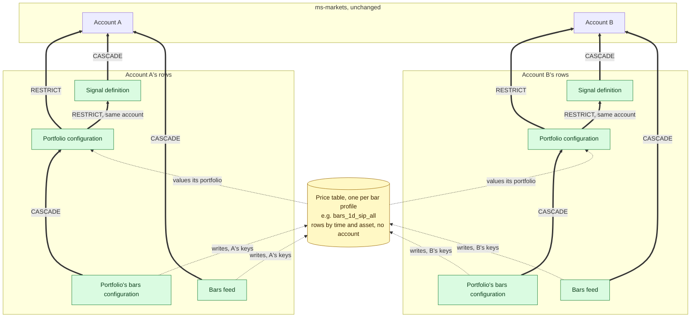
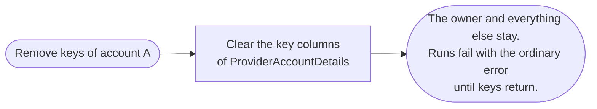
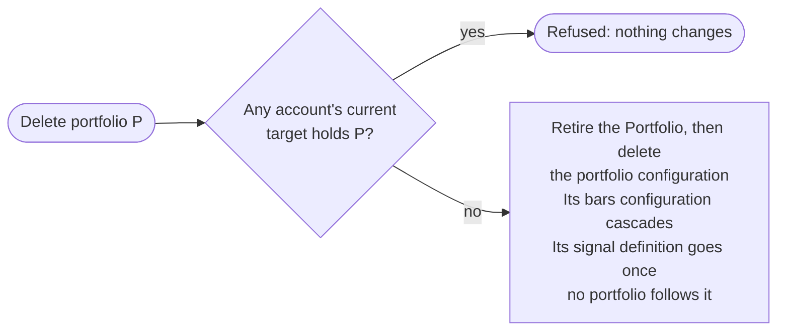
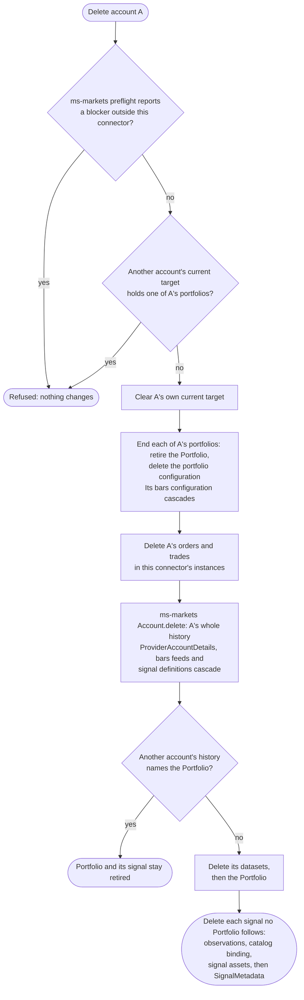

# ADR 0028: Every Portfolio Belongs To One Account

## Status

Accepted by the owner on 2026-11-18; the decisions marked (owner) were made on 2026-11-17 and
2026-11-18. Implemented on the branch `account-owned-portfolios`: revision `0029`, the signal
definitions, the account delete and the removal of keys, and the `portfolio adopt` rollout
command (decision 10).

Amended by the owner on 2026-11-18, after the release: nothing that worked before this ADR is
blocked. ADR 0024's routes stay, with the rules they had, because Hunch uses them (decision 3). A
portfolio that cannot be adopted keeps working as before, on its own signal and the `portfolios`
feed it names, and `portfolio adopt` never ends a portfolio or deletes a bars configuration
(decisions 9 and 10).

Amended again on 2026-11-18: deleting a portfolio deletes the signal definition it followed once
no other portfolio follows it (issue #38, decision 5), and a portfolio run first fetches the bars
its signal needs (issue #39).

It builds on [ADR 0027](0027_one_portfolio_path.md): every portfolio here is built from weights
an application provides, the one kind that remains.

Each ADR below carries an "Amended by ADR 0028" line:

| ADR | What changes |
| --- | --- |
| [0003](0003_stored_alpaca_bars_configurations_and_asset_sources.md) | A bars configuration is either its portfolio's own or a feed of its account (decision 4). |
| [0008](0008_portfolio_configuration_and_job_ownership.md) | The portfolio configuration names its account and the signal definition it follows, and its bars configuration names it (decisions 3 to 5). |
| [0011](0011_api_managed_alpaca_credential_secrets.md), [0017](0017_encrypted_account_credentials.md) | Removing keys clears them and keeps the row; deleting an account deletes it (decision 8). |
| [0019](0019_account_owners_vouched_for_by_trusted_applications.md) | The registration becomes `ProviderAccountDetails`, and its owner stays when the keys are removed (decision 7). |
| [0021](0021_daily_bars_dispatcher.md) | The blocked-portfolio rule reads the portfolio's own bars configuration (decision 4). |
| [0022](0022_configurations_never_block_an_owners_removal.md) | Its decision 1 is withdrawn (decision 8). Its decisions 2 and 3 are restated by decision 3. |
| [0024](0024_portfolios_from_provided_weights.md) | Weights are published to a signal definition by the application's key (decision 5). Its decision 5, the bars naming, changes (decision 4). |
| [0027](0027_one_portfolio_path.md) | `alpaca_connectors__portfolio_configuration` gains the account and the signal definition and loses its bars key (decisions 3 to 5). Removing an account no longer disables bar configurations (decision 8). |

## Context

### ms-markets primitives and their relationships

ms-markets is the ontology, and this ADR changes none of it. These are its relationships, as
release 4.0.1 defines them. "Key" is the column of the row on the left; the last column is what
happens to that row when the row it names is deleted.

| Row | Names | Key | On delete of the named row |
| --- | --- | --- | --- |
| `Portfolio` | its `Calendar` | `calendar_uid` | `RESTRICT` |
| `Portfolio` | the signal it follows, if any | `signal_uid`, written by each portfolio run | `RESTRICT` |
| A portfolio's datasets: weights, values, rebalance state, analytics, ledger, state and cash flows | their `Portfolio` | `portfolio_identifier` (its `unique_identifier`) | `RESTRICT` |
| A portfolio's dataset availability and group memberships | their `Portfolio` | `portfolio_uid` | `CASCADE` |
| Signal weights, the observations | their signal, and each asset | `signal_uid`, `asset_identifier` | `RESTRICT` |
| Target positions (`TargetPositionsStorage`), an account's target snapshots | each portfolio they name | `portfolio_uid` | `RESTRICT` |
| `VirtualFund` | the portfolio it holds | `target_portfolio_uid` | `RESTRICT` |
| `AccountTargetAllocation`, `AccountHoldingsSet`, `VirtualFund`, `OrderManager` | their `Account` | `account_uid`, `target_account_uid` | `CASCADE` |
| A provider's account details, a sidecar in the provider's namespace (ms-markets ADR 0047) | its `Account`, one to one | `uid` = `ms_markets__account.uid` | `CASCADE` |
| Orders and trades | their `Account` | `account_identifier` (its `unique_identifier`) | `RESTRICT` |

What names nothing:

- An `Account` names no portfolio, and a `Portfolio` names no account and has no owner. Its only
  price dependency is a valuation source: a price series and a column (ms-markets ADR 0031).
- A signal (`SignalMetadata`) names nothing: it belongs to nobody, and any `Portfolio` may follow
  any signal. An application signal's identity is `(provider, key)`, where `key` is "the
  provider's own stable key for this stream of weights" (`ApplicationWeightsConfig`); its UID is
  a hash of that identity.

The rules on top of the keys:

- **Retire a portfolio** (ms-markets ADR 0049). It sets `Portfolio.retired_at`, and it is refused
  while any account's current target names the portfolio. A retired portfolio's updaters write
  nothing after that time; its history stays.
- **Delete a portfolio** (ms-markets ADR 0049). The delete removes its weights and values first,
  and it is refused while any target row or virtual fund names it. No route removes a portfolio
  from an account's history, so a portfolio is deleted only once nothing references it.
- **Delete an account** (ms-markets ADR 0050, release 3.3.0: `DELETE /api/v1/account/{uid}/`,
  `Account.delete`). It deletes the account with its whole history in one transaction: orders,
  trades and order events, order managers, allocation lines, virtual funds, targets and holdings.
  Markets deletes only its own rows. Another project's `CASCADE` key goes with the account; its
  `RESTRICT` key refuses the delete until that project removes its rows. Command Center offers the
  same delete as `deleteAccount`.
- **Delete a signal.** `SignalMetadata` is an ordinary row. Its observations and every `Portfolio`
  that follows it refuse the delete (`RESTRICT`).

### What this connector does today

Since ADR 0027 this connector builds one kind of portfolio that ms-markets does not define: one
built from weights an application provides (ADR 0024). Having its own rules for it is correct.
But each portfolio depends on Alpaca accounts and on rows that belong to nobody, and nothing
declares it:

- **The account.** The portfolio configuration records its owner (ADR 0019) but no account. It
  requires a bars configuration with `RESTRICT`, and the bars configuration requires an `Account`
  with `RESTRICT`, only for the keys its runs use. A portfolio may name any enabled bars
  configuration, on anyone's account (ADR 0024, open question 2); the only trace on the portfolio
  is the account name in the portfolio detail's `linked_bars`.
- **The rebalance configuration.** The portfolio configuration requires one with `RESTRICT`. It
  is a shared rule with no owner and no account, which any portfolio may name, and that stays
  (decision 6).
- **The signal.** Each portfolio has one signal, keyed by its configuration's UID. The signal is
  four rows: its `SignalMetadata` in ms-markets, its observations in this connector's
  signal-weights instance, its rows in the signal-asset table and its binding in the Markets
  dataset catalog. No row records whose signal it is: the connector finds it only by computing its
  UID again from the configuration's UID. Deleting a portfolio retires its `Portfolio` and deletes
  the configuration and the signal-asset rows. The retired `Portfolio` keeps following the signal,
  and the other three rows stay with nothing that can find them again.

Because nobody designed these dependencies, their effects are accidental:

- Removal (`remove_account_registration`) deletes the `AlpacaAccountDetails` row with the keys
  and the owner, only deactivates the `Account`, and disables the bar configurations that use its
  keys (ADR 0022). That blocks every portfolio priced through them, other owners' portfolios
  included, and once the owner's only account is gone there is nothing to re-point them to.
- An account's owner controls the inputs of portfolios they may not own, and neither owner is
  told.
- "Removing" an account deletes nothing in ms-markets: its whole history stays. Removal was
  written on 2026-09-03, when ms-markets could not delete an account, and never adopted the
  delete of ms-markets ADR 0050.
- The row that holds an account's Alpaca details and keys is called a "registration". Binance
  (`BinanceSpotAccountDetails`, `BinanceFuturesAccountDetails`) and IBKR (`IBKRAccountDetails`)
  keep the same row under their own names, and each one removes it differently.

## Decision

### 1. ms-markets is not changed (owner)

No table, column, key, delete action or route of ms-markets changes. This connector enforces its
own relationships with five means, all outside ms-markets:

1. **Keys from its own tables to ms-markets rows.** ms-markets' account delete honours them
   (ms-markets ADR 0050): a `RESTRICT` key refuses it from any caller, Command Center included,
   and a `CASCADE` key goes with it.
2. **Keys and checks between its own tables.**
3. **The identity it gives each signal**: the `(provider, key)` of every signal it makes.
4. **Its API's rules**: who may create, change or delete what (ADR 0019 owners).
5. **The order of its calls to ms-markets' API**: clear a target, retire a portfolio, delete a
   portfolio's datasets and then the `Portfolio`, delete a signal, delete an account.

### 2. This connector's restrictions, and what it adds to enforce them (owner)

#### What it adds

Everything is in this connector's namespace. Tables take MetaTables' default `app__concept`
names.

| # | Added | Table | References | On delete | Restriction it enforces |
| --- | --- | --- | --- | --- | --- |
| 1 | Column `account_uid`, required | `alpaca_connectors__portfolio_configuration` | `ms_markets__account.uid` | `RESTRICT` | A portfolio belongs to one account, and that account cannot be deleted while it has one (decision 3). |
| 2 | Table: the signal definition, with `uid`, `account_uid` and the application's `key`, unique per account | `alpaca_connectors__signal_definition` | `ms_markets__account.uid` | `CASCADE` | An account's signals are its own (decision 5). |
| 3 | Column `signal_definition_uid`, required, in the key `(signal_definition_uid, account_uid)` | `alpaca_connectors__portfolio_configuration` | the signal definition's `(uid, account_uid)` | `RESTRICT` | A portfolio follows one signal of its own account (decision 5). |
| 4 | Column `portfolio_configuration_uid` | `alpaca_connectors__bars_configuration` | `alpaca_connectors__portfolio_configuration.uid` | `CASCADE` | A portfolio has its own bars configuration (decision 4). |
| 5 | Column `account_uid` becomes optional, and its delete action changes from `RESTRICT` to `CASCADE` | `alpaca_connectors__bars_configuration` | `ms_markets__account.uid` | `CASCADE` | A bars feed belongs to its account (decision 4). |
| 6 | Check: exactly one of `portfolio_configuration_uid` and `account_uid` | `alpaca_connectors__bars_configuration` | | | A bars configuration has one parent (decision 4). |
| 7 | Column `bars_configuration_uid` removed | `alpaca_connectors__portfolio_configuration` | | | The portfolio no longer names a bars configuration (decision 4). |
| 8 | Row renamed `ProviderAccountDetails` in code; the owner stays when the keys are removed | `alpaca_connectors__acct_alpaca`, kept until the keys are re-encrypted (open question 1) | `ms_markets__account.uid`, one to one | `CASCADE`, as today | The provider sidecar of ms-markets ADR 0047 (decision 7). |
| 9 | Table: an ended portfolio's account, `Portfolio` and signal, with no key | `alpaca_connectors__ended_portfolio` | nothing | | Lets an account delete finish its retired `Portfolio`s and signals (open question 2). |
| 10 | Signal identity: the `ApplicationWeights` key is the account's UID with the application's key | | | | No other account can produce the signal (decision 5). |
| 11 | API rule: only the account's owner creates its signal definitions, and its portfolios through the new route; bars feeds and ADR 0024's routes keep ADR 0022's rules (amended 2026-11-18) | | | | Ownership (decisions 3 to 5). |
| 12 | The ordered calls of the account delete and of a signal's delete | | | | Delete means delete, in the order ms-markets' keys allow (decisions 5 and 8). |

Rebalance configurations get nothing: they stay independent (decision 6).

#### Where the model differs

Two accounts, A and B. Green rows are what this connector adds, each belonging to one account;
thick arrows are their keys, labelled with the delete action. The yellow table is shared: bars
land in one table per bar profile, keyed by time and asset, with no account (decision 4). Dotted
lines are not keys.

#### Each restriction, against what ms-markets alone allows

| Relationship | What ms-markets alone allows | How this connector enforces it |
| --- | --- | --- |
| A portfolio belongs to one account (decision 3). | A `Portfolio` has no account. | The portfolio configuration's required `account_uid` references `ms_markets__account.uid` with `RESTRICT`. Its `Portfolio` is the one its `portfolio_uid` names, with the identifier `ALPACA_PORTFOLIO__<configuration UID>`. |
| Only the account's owner creates and changes what belongs to the account. | ms-markets has no owners. | API rule: the acting owner (ADR 0019) must be the owner in `ProviderAccountDetails`, and nobody acts on an account without an owner. |
| A portfolio's prices are fetched with its account's keys (decision 4). | A `Portfolio`'s only price dependency is its valuation source. | The portfolio's bars configuration references its portfolio configuration with `CASCADE`. A check allows a bars configuration exactly one parent: its portfolio configuration or its account. |
| An account's signals are its own (decision 5). | A signal belongs to nobody, and its identity is `(provider, key)`. | The signal definition references the `Account` with `CASCADE`. Its ms-markets key is the account's UID with the application's key, so no other account can produce the same signal. |
| A portfolio follows one signal of its own account (decision 5). | A `Portfolio` may follow any signal. | The portfolio configuration's `(signal_definition_uid, account_uid)` references the definition's `(uid, account_uid)` with `RESTRICT`, so the database refuses another account's definition. The portfolio run sets `Portfolio.signal_uid` from that definition only. |
| A signal's rows go with its definition (decision 5). | `SignalMetadata` has no owner; its observations and the `Portfolio`s that follow it refuse its delete. | Deleting a definition's signal deletes its observations, its catalog binding, its signal-asset rows and then its `SignalMetadata`, once no `Portfolio` follows it. |
| Deleting an account deletes everything it owns (decision 8). | The account delete removes the account's history and honours other projects' keys. | The ordered calls of decision 8. |

### 3. Every portfolio belongs to one account (owner)

- The portfolio configuration gets a required `account_uid` that references
  `ms_markets__account.uid` with `RESTRICT`.
- The ms-markets `Portfolio` stays account-free. The ownership is this connector's rule.
- Other accounts may still hold the portfolio in their targets and virtual funds (owner).
- Only the account's owner creates portfolios on it through `POST /v1/portfolio-configurations`,
  and nobody does on an account without an owner until it takes one at its next key registration
  (ADR 0019 section 8) (owner). ADR 0024's create keeps the rules it had: the caller owns the
  portfolio, a named feed is not checked, and an inline one needs an account the caller may
  configure (ADR 0022) (owner, amended 2026-11-18).
- `RESTRICT`, not `CASCADE`: a cascade would delete this connector's rows inside ms-markets'
  account delete without retiring the `Portfolio` (the state of
  [issue #33](https://github.com/mainsequence-projects/alpaca-connectors/issues/33)) and without
  decision 8's refusal. With `RESTRICT`, ms-markets refuses an account delete from any caller,
  Command Center included, until this connector has ended the account's portfolios.

### 4. A bars configuration has exactly one parent (owner)

| Kind | Names | Delete action | Keys | What it prices |
| --- | --- | --- | --- | --- |
| A portfolio's bars configuration | its portfolio configuration | `CASCADE` | its portfolio's account | that portfolio's assets |
| A bars feed | its `Account` | `CASCADE` | its account | explicit assets, the account's holdings, or the portfolios not yet adopted that name it (`portfolios`, amended), into the shared price table |

- A check allows exactly one of the two names. Each portfolio has one bars configuration of its
  own (owner); the portfolio configuration no longer names one.
- "Daily IVV Update", which fills the `1d/sip/all` table that Hunch reads, is a feed (owner).
- Prices land in one shared table per bar profile (frequency, feed and adjustment), such as
  `alpaca_connectors__bars_1d_sip_all`, whichever account's configuration fetched them
  (ADR 0024, `market_data/storage.py`). Its rows are keyed by time and asset and name no account.
  The account gives a run its keys, and a holdings feed its assets. A portfolio's bars
  configuration picks the profile, and the portfolio is valued from the shared table.
- Deleting an account deletes its bars configurations, never price rows.

### 5. One kind of signal, owned by one account (owner)

ms-markets' signal is unchanged: a signal belongs to nobody, and any `Portfolio` may follow any
signal. This connector builds one kind of portfolio (ADR 0027), so it makes one kind of signal,
and only for an account. Its portfolios follow nothing else (owner).

- **The signal definition** belongs to one account (`CASCADE`) and is created by the account's
  owner. The application gives its key, unique within the account.
- **Its signal** is ms-markets' `ApplicationWeights` with provider `alpaca-connectors` and a key
  made of the account's UID and the application's key. Two accounts never produce the same
  signal, and no account's key blocks another's.
- **Who follows it.** A portfolio configuration follows one definition of its own account
  (`RESTRICT`), and one definition may feed any number of the account's portfolios. The
  application publishes observations to the definition, not to a portfolio.
- **Its rows.** The signal's `SignalMetadata`, its observations in this connector's
  signal-weights instance, its signal-asset rows and its catalog binding belong to the definition.
  They are deleted with it, observations first and `SignalMetadata` last, once no `Portfolio`
  follows the signal. ms-markets refuses the delete while one does, so a signal followed by a
  retired `Portfolio` that an account's history keeps (ms-markets ADR 0049) stays with it, and
  its key cannot be given again while it stays.

### 6. Rebalance configurations stay independent (owner)

A rebalance configuration is a reusable rule with no owner and no account, and it stays so for
now (owner). Any portfolio may name one, with `RESTRICT` as today, and an account delete never
touches one.

### 7. `ProviderAccountDetails` replaces the registration (owner)

- The `AlpacaAccountDetails` row is this connector's provider account sidecar (ms-markets
  ADR 0047). Its name becomes `ProviderAccountDetails`, the same name for every provider. Its
  catalog identifier and table become `ProviderAccountDetails` and
  `alpaca_connectors__provideraccountdetails`, MetaTables' default `app__concept` name, when the
  keys are re-encrypted; until then the code name alone changes (open question 1).
- One row per `Account`, keyed by `ms_markets__account.uid` with `CASCADE`, as today. It holds
  the owner, the encrypted keys (ADR 0017) and the Alpaca account's identity and status.
- The owner stays when the keys are removed (owner). Only the owner can register keys again.
- Code and docs stop calling it a registration.

### 8. Removing keys and deleting an account are separate actions (owner)

**Remove keys** clears the key columns of `ProviderAccountDetails`. The owner, the `Account`, its
history, its portfolios and their configurations stay. Nothing is disabled or blocked: a run
without valid keys fails with the ordinary error (owner).

**Delete account** deletes the account and everything that belongs to it. The order is the one
ms-markets' `RESTRICT` keys impose: the account's history before its `Portfolio`s, a `Portfolio`
before the signal it follows.

1. It is refused before anything changes when ms-markets' account delete preflight reports a
   blocker outside this connector, or when another account's current target holds one of the
   account's portfolios. The second is ms-markets' rule (its ADR 0049), not a check of this
   connector (owner).
2. The account's own current target also names its portfolios, and ms-markets refuses to retire
   a portfolio that any current target names, so that target is cleared first.
3. Each portfolio ends the way ADR 0027 (decision 4) ends every portfolio: the `Portfolio` is
   retired, and the portfolio configuration is deleted with its bars configuration. A portfolio
   not yet adopted that a `portfolios` feed of the account prices runs with the account's keys,
   so it ends too (amended 2026-11-18).
4. This connector deletes the account's orders and trades in its own instances, whose
   `RESTRICT` keys would refuse the next step.
5. ms-markets' `Account.delete` deletes the account with its whole history.
   `ProviderAccountDetails`, the account's bars feeds and its signal definitions go with it. A
   registration made before revision `0018` still names the Main Sequence Secrets its keys were
   in; those this application created are deleted next, as removing the keys deletes them.
6. Each retired `Portfolio` of the account that no other account's history names is deleted, its
   datasets first. One that another account's history names stays retired (ms-markets ADR 0049).
7. Each of the account's signals that no `Portfolio` follows any more is deleted as decision 5
   says. A signal that a kept `Portfolio` follows stays with it.

### 9. Existing rows (owner)

ADR 0027's drain has ended the portfolios it removes before this decision runs. Of the
portfolios that remain:

- One whose bars configuration's account is not owned by the portfolio's owner cannot be given
  one owning account. It stays as it is and keeps working as before: it publishes to its own
  signal, keyed by its configuration UID, runs on the `portfolios` feed it names, and that feed
  keeps pricing it (owner, amended 2026-11-18; it was to be ended).
- One that stays belongs to its bars configuration's account. It gets a signal definition on that
  account that keeps its current signal: the definition's ms-markets key stays its configuration's
  UID, today's key, so its signal and weights history continue. No other account can produce
  that key.
- Each one adopted gets a bars configuration of its own, with the profile of the one it names.
  Every bars configuration that existed stays a feed of its account; a `portfolios` feed keeps
  pricing the portfolios not yet adopted that name it, and nothing deletes it (amended).

### 10. Rollout

Hosted schema changes come only from the workflow's migration Job, and revisions add first and
drop later (ADR 0012, `AGENTS.md`).

- **Revision `0029`**, after ADR 0027's `0027` and `0028`, adds the signal definitions and the
  ended portfolios, the portfolio's account and signal definition (nullable for now) with their
  keys, and the bars configuration's portfolio parent with the one-parent check; the bars
  configuration's account key becomes `CASCADE`. It relaxes the portfolio's former bars key, which
  the release still serving during the rollout writes. In the database, it adopts every portfolio
  its own owner can own (decision 9).
- **`alpaca-connectors portfolio adopt`**, a dry run and then `--execute`, adopts what the
  previous release wrote meanwhile, and what becomes adoptable later, and leaves the rest as they
  are. It never ends a portfolio or deletes a bars configuration (amended 2026-11-18).
- **No revision** refuses to run while a portfolio is not adopted: the account and the signal
  definition stay nullable while any portfolio is, and so does the former bars key. ADR 0024's
  routes stay supported (amended 2026-11-18).

## Reference

What each removal does. The model diagram is in decision 2.

### Remove keys

### Delete a portfolio

### Delete an account

## Where the code differed before this ADR

| Decision | Before | Where it was |
| --- | --- | --- |
| 3 | The portfolio configuration records an owner but no account. | `portfolios/configurations.py:215` (the table), `:419` and `:431` (the owner) |
| 4 | Every bars configuration requires an account, and the portfolio names its bars configuration. | `market_data/configurations.py:110`, `portfolios/configurations.py:291` |
| 5 | There is no signal definition. The signal's key is the portfolio configuration's UID, observations are published per portfolio, and deleting a portfolio leaves its `SignalMetadata`, observations and catalog binding. | `portfolios/provided_weights.py:85`, `:113`, `:218`, `:238`, `:320` and `:421`; `POST /v1/portfolio-configurations/provided-weights` and `POST /v1/portfolio-configurations/{configuration_uid}/weights` (`api/app/routers/portfolio_configurations.py:101` and `:116`) |
| 7 | The row is `AlpacaAccountDetails` in `alpaca_connectors__acct_alpaca`, called a registration. | `account/alpaca_account_details.py:153` |
| 8 | Removal disables the bar configurations on the account's keys, deletes the row with the owner and deactivates the `Account`. | `account/services.py:1079` |

Paths are under `src/alpaca_connectors/`.

## Alternatives considered

- **Enforce the ownership in ms-markets**, with an account or owner on `Portfolio` or
  `SignalMetadata`. Rejected: ms-markets is the ontology, and its primitives stay as they are
  (owner). The connector's own keys reach the same result, and ms-markets' account delete already
  honours them.
- **Keep the account on the configurations and cascade from them.** Move the bars configuration's
  key to the registration with `CASCADE` and make the portfolio's bars key `SET NULL`, blocking
  the portfolio until it is re-pointed. Rejected: the portfolio keeps an undeclared owner, and
  once the owner's only account is gone there is nothing to re-point it to.
- **A `CASCADE` key from the portfolio configuration to the `Account`.** Rejected for decision 3's
  reason.
- **Keep the signal keyed by its portfolio.** Rejected: the key is the application's
  (`ApplicationWeightsConfig`), and one signal may feed many portfolios of its account (owner).
- **A signal that belongs to nobody, with the application's key unique in the connector.**
  Rejected: one account's key would block every other account, and a deleted account's signal
  would come back, with its history, to whoever used the key again.
- **Rebalance configurations owned by an account.** Rejected for now: they are independent rules
  (owner).
- **Prices from an account Main Sequence owns.** Portfolios would stay independent of their
  owners' accounts. Rejected: an Alpaca portfolio never exists without its account (owner).
- **A cascade in ms-markets into other accounts' targets.** Rejected: ms-markets keeps other
  accounts' history (its ADR 0049 removed `bulk-cascade-delete`), and this connector works within
  that.
- **Keep one removal that deletes nothing.** Rejected: a delete must delete (owner).

## Consequences

- ms-markets is unchanged. Every rule of this ADR lives in this connector's tables, API and calls.
- Removing keys never stops anything by design; runs fail until keys return, and the owner keeps
  the account.
- Deleting an account deletes its portfolios, bars feeds, signal definitions and their signals,
  and its whole ms-markets history. It is refused while another account currently holds one of
  its portfolios. A `Portfolio` that another account's history names stays retired, with its
  signal.
- A portfolio created through `POST /v1/portfolio-configurations` depends on no other owner's
  account or signal. Rebalance configurations stay shared rules (decision 6).
- Applications publish to a signal definition by their own key, and several portfolios of the
  same account can follow it. ADR 0024's routes keep their rules, so Hunch needs no change.
- ADR 0022's removal behaviour, its owner checks on the configuration routes and its claim refusal
  are withdrawn or restated.
- A portfolio whose bars run on another owner's account stays unadopted and keeps working
  (decision 9, amended).

## Open Questions

1. **Moving the keys to the new table.** Resolved on 2026-11-18. MetaTables binds every encrypted
   value to its table and column, and the migration Job does not hold
   `ALPACA_CONNECTORS_DATA_KEY`. So the code calls the row `ProviderAccountDetails` now, and its
   catalog identifier and table keep their names, so the keys keep decrypting. The identifier and
   the table move later, with a step that re-encrypts the keys.
2. **Remembering what is left to delete.** Resolved on 2026-11-18:
   `alpaca_connectors__ended_portfolio` records each ended portfolio's account, `Portfolio` and
   signal, with no key to the account. Deleting a portfolio writes it; the account delete reads it
   to delete the retired `Portfolio`s and signals, and deletes each record once its `Portfolio` is.
